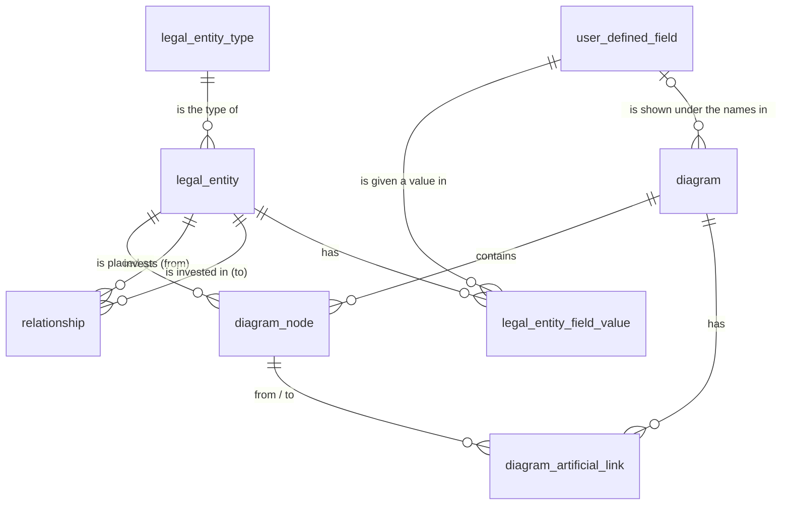

# Database

The database of the fund-structure editor, for PostgreSQL 14 or newer. This is the first step
towards a backend: the tables exist and are checked, but the app does not read or write them yet.

- [The idea](#the-idea)
- [The structure in one picture](#the-structure-in-one-picture)
- [The tables](#the-tables)
- [User-defined fields](#user-defined-fields)
- [How the app's data maps onto it](#how-the-apps-data-maps-onto-it)
- [What follows from sharing legal entities](#what-follows-from-sharing-legal-entities)
- [Creating the database](#creating-the-database)
- [Connecting from DataGrip](#connecting-from-datagrip)
- [If you do not know the password](#if-you-do-not-know-the-password)
- [Queries to start with](#queries-to-start-with)
- [What was checked](#what-was-checked)
- [Not decided yet](#not-decided-yet)

## The idea

**Every node of a diagram is a legal entity in the database, and a legal entity can be in several
diagrams or in none.**

So the data falls into two groups:

- **Facts, shared by all diagrams.** A fund has one name and one legal entity type, wherever it is
  drawn. That one fund owns 64% of another is true whichever diagram shows it.
- **One diagram's own data.** Where a fund stands in a diagram, which colour and shape it has
  there, the comment on it there, and the artificial links drawn in it.

**A relationship does not depend on the diagram.** Two funds that have a relationship have it in
every diagram: wherever both are placed, the line between them is drawn, with the same kind and
the same percentage. A diagram cannot hide it and does not have to add it.

**An artificial link is the opposite.** It is a dashed line that somebody drew between two nodes
of one diagram. It exists in that diagram only, has no percentage, and says nothing about the two
funds anywhere else. It is kept in a table of its own, so it can never be taken for a
relationship.

## The structure in one picture



| Group                         | Tables                                                                                                |
| ----------------------------- | ----------------------------------------------------------------------------------------------------- |
| Facts, shared by all diagrams | `legal_entity_type`, `legal_entity`, `relationship`, `user_defined_field`, `legal_entity_field_value` |
| One diagram's own data        | `diagram`, `diagram_node`, `diagram_artificial_link`                                                  |

The SQL is in [backend/db/001_schema.sql](backend/db/001_schema.sql).

## The tables

### `legal_entity_type`: the kinds of fund

| Column | Type   | Notes                                              |
| ------ | ------ | -------------------------------------------------- |
| `id`   | bigint | primary key                                        |
| `name` | text   | unique, not empty: "Private equity", "Feeder fund" |

Starts with the eight types the app has today
([backend/db/002_seed.sql](backend/db/002_seed.sql)). A type typed by hand becomes a new row.

### `legal_entity`: one fund, wherever it is drawn

| Column                     | Type         | Notes                                    |
| -------------------------- | ------------ | ---------------------------------------- |
| `id`                       | bigint       | primary key; also the node's key in GoJS |
| `name`                     | text         | not empty; the node's title              |
| `legal_entity_type_id`     | bigint       | the row of `legal_entity_type`           |
| `created_at`, `updated_at` | timestamptz  | set by the database                      |
| `created_by`, `updated_by` | bigint, null | for users, once there are any            |

An entity with no row in `diagram_node` is in no diagram. That is allowed.

### `relationship`: a fact, who invests in whom and how much

| Column                                                 | Type         | Notes                                                                     |
| ------------------------------------------------------ | ------------ | ------------------------------------------------------------------------- |
| `id`                                                   | bigint       | primary key, from the counter `link_key_seq`; also the link's key in GoJS |
| `from_legal_entity_id`                                 | bigint       | the fund that invests                                                     |
| `to_legal_entity_id`                                   | bigint       | the fund it invests in                                                    |
| `kind`                                                 | text         | `hierarchy` (main holding) or `relation` (co-investment)                  |
| `ownership_percent`                                    | numeric(5,2) | 0.01 to 100.00; null when not known                                       |
| `created_at`, `updated_at`, `created_by`, `updated_by` |              | as above                                                                  |

Rules the database enforces:

- An entity cannot have a relationship with itself.
- One relationship per pair of entities, whichever way it points. The app has the same rule.
- A fund has at most one main holding (`hierarchy`) into it. That is what makes the tree.

### `diagram`: one diagram and its settings

| Column                                                 | Type         | Notes                                                                             |
| ------------------------------------------------------ | ------------ | --------------------------------------------------------------------------------- |
| `id`                                                   | bigint       | primary key                                                                       |
| `name`                                                 | text         | not empty: a saved diagram must have a name                                       |
| `description`                                          | text         | may be empty                                                                      |
| `layout_type`                                          | text         | `top-bottom`, `bottom-top`, `circle`, `layered`, `force`, `grid`                  |
| `link_type`                                            | text         | `avoid`, `orthogonal`, `straight`, `curved`                                       |
| `cards_expanded`                                       | boolean      | whether "Expand all" is on                                                        |
| `subtitle_field`                                       | text, null   | `legalEntityType` or null: the built-in field shown under the names               |
| `subtitle_user_defined_field_id`                       | bigint, null | or the user-defined field shown under the names; at most one of the two is set    |
| `version`                                              | integer      | goes up with every save, so that two people cannot overwrite each other unnoticed |
| `created_at`, `updated_at`, `created_by`, `updated_by` |              | as above                                                                          |

### `diagram_node`: a legal entity placed in a diagram

| Column            | Type             | Notes                                                              |
| ----------------- | ---------------- | ------------------------------------------------------------------ |
| `diagram_id`      | bigint           | the diagram; deleting the diagram deletes its nodes                |
| `legal_entity_id` | bigint           | the entity; an entity that is in a diagram cannot be deleted       |
| `shape`           | text             | one of the six shapes; `Rectangle` unless said otherwise           |
| `color`           | text             | `#rrggbb`; `#f3f4f6` (light gray) unless said otherwise            |
| `x`, `y`          | double precision | top left corner; both null means "not placed yet, the layout does" |
| `comment`         | text             | may be empty                                                       |

The primary key is the pair (`diagram_id`, `legal_entity_id`). So an entity is in a diagram **at
most once**, and in as many diagrams as you like.

`x` and `y` are `double precision` on purpose. The app compares positions to the last digit after
an undo, and this type gives back exactly the number it was given.

### `diagram_artificial_link`: a dashed line of one diagram

A line that the user drew between two nodes of a diagram. It is **not** a relationship: it is
drawn dashed, has no kind and no percentage, and exists in this diagram only. In the app it is the
line drawn by hand (`category: 'manual'`).

| Column                 | Type   | Notes                                                 |
| ---------------------- | ------ | ----------------------------------------------------- |
| `id`                   | bigint | primary key; also the link's key in GoJS              |
| `diagram_id`           | bigint | the diagram; deleting it deletes its artificial links |
| `from_legal_entity_id` | bigint | must be a node of this diagram                        |
| `to_legal_entity_id`   | bigint | must be a node of this diagram                        |

Rules the database enforces:

- Both ends are nodes of the same diagram. Taking a node out of a diagram takes its artificial
  links out of that diagram.
- One artificial link per pair of nodes in a diagram, and none from a node to itself.
- **Two nodes are joined by one line at most.** Two legal entities that have a relationship cannot
  be given an artificial link as well. And when two entities get a relationship, it takes the place
  of the artificial links that were drawn between them, in every diagram.

### The lines of a diagram

So a diagram has no table of "its relationships". Its lines are worked out when it is read:

1. every relationship whose two legal entities are both nodes of the diagram, and
2. the diagram's artificial links.

Relationships and artificial links take their `id` from one counter (`link_key_seq`). The id is
the key of the line in GoJS, and this way no two lines of a diagram have the same key.

## User-defined fields

Besides its name and its legal entity type, a legal entity can have fields that users define
themselves, such as "Jurisdiction" or "Inception date". **Each entity has a given field or does not
have it.** Like the name, a value belongs to the entity and is the same in every diagram.

### `user_defined_field`: a field somebody has defined

| Column                                                 | Type    | Notes                                                                     |
| ------------------------------------------------------ | ------- | ------------------------------------------------------------------------- |
| `id`                                                   | bigint  | primary key                                                               |
| `name`                                                 | text    | not empty; unique whatever the capitals ("Jurisdiction" = "JURISDICTION") |
| `data_type`                                            | text    | `text`, `number`, `date` or `boolean` (yes/no)                            |
| `is_optional`                                          | boolean | true unless said otherwise; see below                                     |
| `created_at`, `updated_at`, `created_by`, `updated_by` |         | as in the other tables                                                    |

### `legal_entity_field_value`: an entity that has a field, and its value

| Column                                                 | Type          | Notes                                      |
| ------------------------------------------------------ | ------------- | ------------------------------------------ |
| `legal_entity_id`                                      | bigint        | the entity; deleting it deletes its values |
| `user_defined_field_id`                                | bigint        | the field; deleting it deletes its values  |
| `value_text`                                           | text, null    | the value of a `text` field                |
| `value_number`                                         | numeric, null | the value of a `number` field              |
| `value_date`                                           | date, null    | the value of a `date` field                |
| `value_boolean`                                        | boolean, null | the value of a `boolean` field             |
| `created_at`, `updated_at`, `created_by`, `updated_by` |               | as in the other tables                     |

The primary key is the pair (`legal_entity_id`, `user_defined_field_id`): an entity has a field at
most once.

What a row means:

| In the table                           | Meaning                                   |
| -------------------------------------- | ----------------------------------------- |
| No row for this entity and this field  | The entity does not have the field        |
| A row with all four value columns null | The entity has the field, and it is empty |
| A row with one value column filled     | The entity has the field, with that value |

There are four value columns, one per type, so that a number is stored as a number and a date as a
date: they sort and compare correctly, and "abc" cannot get into a number field.

Rules the database enforces:

- A value is of its field's type: it stands in the column that goes with `data_type`.
- **Optional or required.** An optional field may be left empty on an entity that has it. A
  required field (`is_optional` false) may not: the entity either does not have the field, or has
  it with a value.
- A field cannot be made required while some entity has it empty.
- The type of a field cannot be changed while entities have values for it.
- A text value is not just spaces; an empty text is stored as "no value".

A diagram can show one such field under the names of its nodes, through
`diagram.subtitle_user_defined_field_id`. That is what the dropdown of the dialog "Styles by legal
entity field" is for; today it offers the built-in "Legal entity type" only. Deleting the field
makes those diagrams show nothing there.

## How the app's data maps onto it

| In the app today (`src/app/diagram/`)                                     | In the database                                                                                      |
| ------------------------------------------------------------------------- | ---------------------------------------------------------------------------------------------------- |
| `NodeData.key`                                                            | `legal_entity.id`                                                                                    |
| `NodeData.title`                                                          | `legal_entity.name`                                                                                  |
| `NodeData.legalEntityType`                                                | `legal_entity_type.name`, through `legal_entity`                                                     |
| `NodeData.shape`, `color`, `comment`, `loc` ("x y")                       | `diagram_node.shape`, `color`, `comment`, `x`, `y`                                                   |
| `LinkData.key`, `from`, `to`                                              | `id`, `from_legal_entity_id`, `to_legal_entity_id` of `relationship` or of `diagram_artificial_link` |
| `LinkData.category` `hierarchy` or `relation`                             | `relationship.kind`                                                                                  |
| `LinkData.category` `manual`                                              | a row of `diagram_artificial_link`                                                                   |
| `LinkData.ownership`                                                      | `relationship.ownership_percent`                                                                     |
| `ModelData` (name, description, layout, line type, cards, subtitle field) | the columns of `diagram`                                                                             |
| The undo history                                                          | not stored: it lives for the session, as today                                                       |
| (nothing yet)                                                             | `user_defined_field`, `legal_entity_field_value`: the app has no user-defined fields so far          |

## What follows from sharing legal entities

To be aware of while the backend is built on these tables:

- **Renaming a node** in one diagram renames the legal entity, so the new name shows in every
  diagram it is in. The same holds for its legal entity type and for an ownership percentage.
- **Deleting a node** in a diagram takes the entity out of that diagram only. The entity and its
  relationships stay in the database.
- **A relationship shows in every diagram** that has both of its funds. Placing an existing fund
  in a diagram brings along its relationships with the funds already there.
- **Removing the line of a relationship** therefore cannot mean "do not show it here": it would
  delete the relationship, in every diagram. Whether the app allows that from a diagram, and how
  it asks, is to be decided when saving is built.
- **Removing an artificial link** removes it from its diagram, and that is all there is of it.
- **Add node** will need a choice: a new legal entity, or one that exists already.
- **A legal entity cannot be deleted** while it is in any diagram.

## Creating the database

You need a running PostgreSQL server, version 14 or newer, and the name and password of a user
who may create databases there (after a standard installation: `postgres`).

One script creates the database `fund_diagrams`, its tables and the eight legal entity types. It
asks for the password once (if you do not know it, see
[below](#if-you-do-not-know-the-password)).

```bash
backend/db/setup.sh
```

With something to look at: the app's "Sample fund structure" of 24 funds as one diagram, four
user-defined fields with a few values, and 44 more diagrams that each show some of the same funds
(45 diagrams make three pages of the list):

```bash
backend/db/setup.sh --with-sample
```

The script takes the server's address from the usual variables and uses `localhost`, port `5432`
and user `postgres` when they are not set. **The PostgreSQL 14 on this machine listens on port
5433**, so here it is:

```bash
PGPORT=5433 backend/db/setup.sh --with-sample
```

To start over, drop the database and run the script again:

```bash
dropdb --host localhost --port 5433 --username postgres fund_diagrams
```

| File                                                                   | What it does                                                                                                   |
| ---------------------------------------------------------------------- | -------------------------------------------------------------------------------------------------------------- |
| [backend/db/001_schema.sql](backend/db/001_schema.sql)                 | The eight tables, their rules and their indexes                                                                |
| [backend/db/002_seed.sql](backend/db/002_seed.sql)                     | The eight legal entity types                                                                                   |
| [backend/db/003_sample_diagram.sql](backend/db/003_sample_diagram.sql) | Optional: one diagram and four fields, for a database still empty                                              |
| [backend/db/004_more_diagrams.sql](backend/db/004_more_diagrams.sql)   | Optional, after the sample: 44 more diagrams of the same funds, to try the list of diagrams and its pages with |
| [backend/db/setup.sh](backend/db/setup.sh)                             | Creates the database and runs the files above                                                                  |

## Connecting from DataGrip

Create the database first (see above). Then:

1. In DataGrip open the **Database** tool window (View → Tool Windows → Database).
2. Press **+** → **Data Source** → **PostgreSQL**.
3. Fill in:

   | Field          | Value                                                      |
   | -------------- | ---------------------------------------------------------- |
   | Name           | anything, for example `fund_diagrams (local)`              |
   | Host           | `localhost`                                                |
   | Port           | `5433` on this machine (PostgreSQL's usual port is `5432`) |
   | Authentication | User & Password                                            |
   | User           | `postgres`                                                 |
   | Password       | the password you chose when PostgreSQL was installed       |
   | Database       | `fund_diagrams`                                            |

   The URL field then reads `jdbc:postgresql://localhost:5433/fund_diagrams`.

4. If DataGrip shows **Download missing driver files** at the bottom of the dialog, click it.
5. Press **Test Connection**. It should say "Succeeded".
6. Press **OK**.

The tables are under `fund_diagrams` → `public` → `tables`. If you see no tables, open the data
source's **Schemas** tab (or press the "…" next to the data source in the tree) and tick `public`.

To look at the structure as a picture: right-click `public` → **Diagrams** → **Show Diagram**.

If the connection is refused:

- **"Connection refused"**: the port is wrong or the server is not running. `pg_isready -h
localhost -p 5433` says whether a server answers there.
- **"password authentication failed"**: the user or the password is wrong.
- **"database "fund_diagrams" does not exist"**: run the setup script first.

## If you do not know the password

PostgreSQL does not keep passwords in a readable form, so the password of `postgres` cannot be
looked up in the database or in its files. There are three ways on.

**1. Find where it was saved.** It was chosen when PostgreSQL was installed, and tools often keep
it:

- **pgAdmin 4** (installed with PostgreSQL, in `/Applications/PostgreSQL 14`): open it; if the
  server connects without asking, the password is saved there, but pgAdmin does not show it.
- **Keychain Access** on the Mac: search for `postgres` or `pgAdmin`. A saved password can be
  shown there with your Mac password.
- **Your password manager** or notes, under "PostgreSQL" or "postgres".
- **DataGrip**, if this server was ever set up in it: the data source keeps the password, but does
  not show it either.

**2. Set a new one.** This needs your Mac's administrator password, because the server's files
belong to the user `postgres`. In short: let the server trust local connections for a moment, set
the password, and switch the trust off again.

1. In `/Library/PostgreSQL/14/data/pg_hba.conf`, on the lines that begin with `host` and end with
   `scram-sha-256` (or `md5`), change that last word to `trust`. Keep a copy of the file first.
2. Tell the server to read the file again:
   `sudo -u postgres /Library/PostgreSQL/14/bin/pg_ctl reload -D /Library/PostgreSQL/14/data`
3. Connect without a password and set a new one:
   `psql -h localhost -p 5433 -U postgres -c "\password postgres"`
4. Put the old words back in `pg_hba.conf` and reload as in step 2. Until you do, anyone on this
   Mac can connect without a password.

**3. Do without it.** The project can run a PostgreSQL server of its own, in a folder of the
project, started as you and with a password you choose now. Nothing of the installed server is
touched. This is not set up yet; say so if you want it.

## Queries to start with

A diagram as the app needs it, in three queries (here for the diagram with id 1):

```sql
-- Its settings
select * from diagram where id = 1;

-- Its nodes
select e.id as key, e.name as title, t.name as legal_entity_type,
       n.shape, n.color, n.comment, n.x, n.y
from diagram_node n
join legal_entity e on e.id = n.legal_entity_id
join legal_entity_type t on t.id = e.legal_entity_type_id
where n.diagram_id = 1
order by e.id;

-- Its lines: the relationships between its nodes, and its artificial links
select r.id as key, r.from_legal_entity_id as "from", r.to_legal_entity_id as "to",
       r.kind as category, r.ownership_percent as ownership
from relationship r
join diagram_node f on f.diagram_id = 1 and f.legal_entity_id = r.from_legal_entity_id
join diagram_node t on t.diagram_id = 1 and t.legal_entity_id = r.to_legal_entity_id
union all
select a.id, a.from_legal_entity_id, a.to_legal_entity_id, 'manual', null
from diagram_artificial_link a
where a.diagram_id = 1
order by key;
```

Which diagrams a legal entity is in:

```sql
select e.name, d.name as diagram
from legal_entity e
join diagram_node n on n.legal_entity_id = e.id
join diagram d on d.id = n.diagram_id
where e.id = 1;
```

The user-defined fields of one legal entity, with their values:

```sql
select f.name, f.data_type, f.is_optional,
       coalesce(v.value_text, v.value_number::text, v.value_date::text, v.value_boolean::text) as value
from legal_entity_field_value v
join user_defined_field f on f.id = v.user_defined_field_id
where v.legal_entity_id = 1
order by f.name;
```

Which legal entities have a given field, and which do not:

```sql
select e.name, (v.legal_entity_id is not null) as has_field
from legal_entity e
left join legal_entity_field_value v
  on v.legal_entity_id = e.id
 and v.user_defined_field_id = (select id from user_defined_field where name = 'Jurisdiction')
order by e.name;
```

Legal entities that are in no diagram:

```sql
select e.*
from legal_entity e
where not exists (select 1 from diagram_node n where n.legal_entity_id = e.id);
```

The diagrams that show a given relationship, which are the ones that have both of its funds:

```sql
select d.id, d.name
from relationship r
join diagram_node f on f.legal_entity_id = r.from_legal_entity_id
join diagram_node t on t.legal_entity_id = r.to_legal_entity_id and t.diagram_id = f.diagram_id
join diagram d on d.id = f.diagram_id
where r.id = 1
order by d.name;
```

## What was checked

The files were run on PostgreSQL 14.1, in a throwaway server that was removed afterwards.

- All files run without error, also through the setup script, with and without the sample.
- The app's sample fund structure (24 funds, 26 relationships) was put in as one diagram and read
  back with the queries above: names, types, shapes, colours, comments, positions, lines, kinds and
  percentages were identical to what the app holds.
- The same entity was placed in a second diagram with another shape, colour and position; both
  diagrams read back correctly, and an entity in no diagram stayed in `legal_entity`.
- A relationship showed in every diagram that had both of its funds, without anything being added
  for it: a second diagram with the funds 1, 2 and 24 had the one relationship between 1 and 2.
- An artificial link showed in its own diagram only, although the other diagram had the same two
  funds. No artificial link had the id of a relationship.
- These were tried and refused by the database: an entity twice in one diagram; a second main
  holding into the same fund; a percentage of 0 and of 101; a relationship of an entity with
  itself; a second relationship between the same two entities, the other way round; deleting an
  entity that is in a diagram; an artificial link to an entity that is not in the diagram; an
  artificial link from a node to itself; a second artificial link between the same two nodes, the
  other way round; an artificial link between two entities that have a relationship, and moving
  one onto such a pair; a diagram without a name; an unknown layout; an unknown shape; a colour
  that is not `#rrggbb`; a position with x but no y; a legal entity without a name; two legal
  entity types of the same name.
- Giving two entities a relationship removed the artificial link that had been drawn between them.
- Taking a node out of a diagram removed its artificial links there and nothing else: the entity
  and its relationships stayed.
- Deleting a diagram removed its nodes and artificial links and left the entities and
  relationships.
- The position `840.4155888772582, 240.75846260198898` came back exactly as stored.
- User-defined fields: an entity with four fields of the four types, an entity with an empty
  optional field, and twenty entities with no field at all read back correctly. Refused: a number
  in a text field; text in a date field; a required field left empty, and emptying one; two values
  at once; the same field twice on one entity; a text of spaces only; two fields of the same name
  in other capitals; a field without a name; an unknown type; changing the type of a field that has
  values; making a field required while an entity has it empty; a diagram showing two fields under
  the names. Deleting a field removed its values and cleared it from the diagram that showed it.

## Not decided yet

- **Stakes into one fund adding up to at most 100%.** A rule across several rows; the plan is to
  check it in the backend rather than in the database.
- **The rule for diagram names** (letters, digits and spaces only). The database only requires a
  name that is not empty. The backend will apply the same check as the app
  (`src/app/diagram/diagram-name.ts`), and the app already cleans a stored name that breaks it.
- **Choice lists** for user-defined fields (a value picked from fixed options). Not built; it
  would add a type and one table for the options.
- **The rest of the API.** The backend can list the diagrams and read one (see the
  [README](README.md#backend)). Saving, and managing legal entities, relationships and fields are
  still to come.
