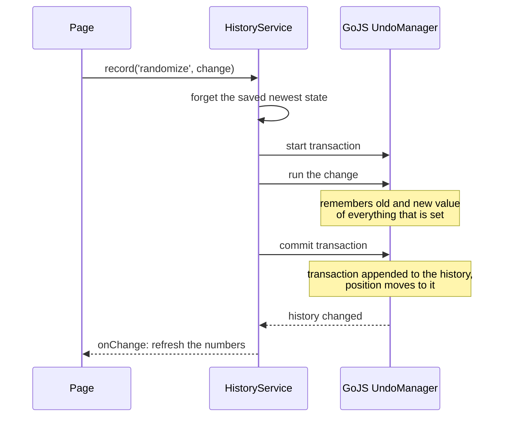
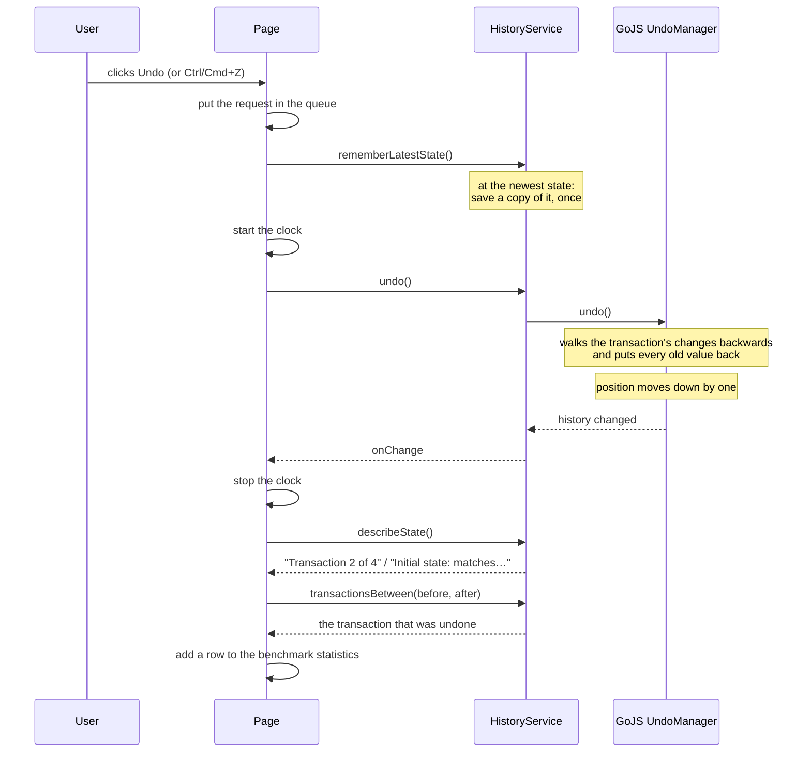
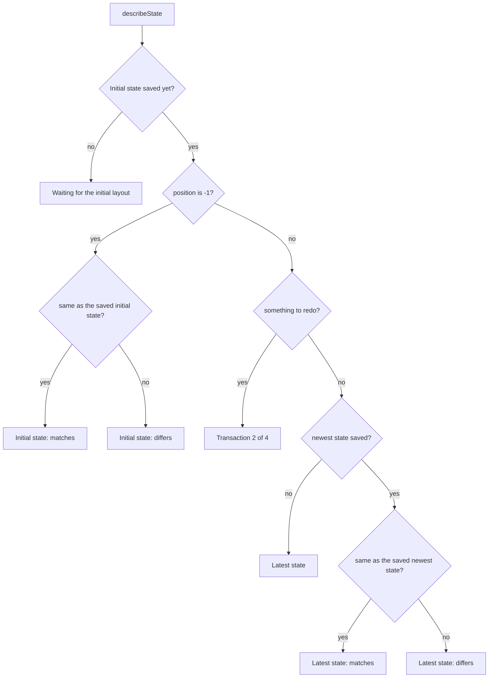

# How undo and redo work

This document explains the undo history of the diagram: the ideas behind it, what happens step by
step when you make a change, undo or redo, and how the app checks that nothing was lost.

All of the code it describes is in one file,
[`src/app/diagram/history.service.ts`](src/app/diagram/history.service.ts). The rest of the app
never talks to GoJS's undo machinery directly; it calls this service.

- [1. The three ideas](#1-the-three-ideas)
- [2. Making a change](#2-making-a-change)
- [3. Undo](#3-undo)
- [4. Redo](#4-redo)
- [5. A new change after an undo](#5-a-new-change-after-an-undo)
- [6. Checking that undo and redo really restore everything](#6-checking-that-undo-and-redo-really-restore-everything)
- [7. Changes that are deliberately not recorded](#7-changes-that-are-deliberately-not-recorded)
- [8. When an action fails halfway](#8-when-an-action-fails-halfway)
- [9. The service at a glance](#9-the-service-at-a-glance)
- [10. Who calls the service](#10-who-calls-the-service)
- [11. Tests](#11-tests)

## 1. The three ideas

GoJS keeps the history in an object called the **UndoManager**. It belongs to the model, which is
the diagram's data. Three ideas are enough to understand it.

**Transaction.** A group of changes that belong together. Everything that changes between "start"
and "commit" becomes one transaction, and one transaction is one undo step. Renaming 30 selected
funds at once is one transaction, so one undo takes all 30 names back.

**History.** The list of committed transactions, oldest first. It is more than a log of what
happened: every transaction remembers the old and the new value of everything it changed. That is
what lets it be undone and redone.

**Position.** Which transaction the diagram is currently at. It is the index of the last
transaction that is applied.

```
history:    [ T0 ]  [ T1 ]  [ T2 ]  [ T3 ]
              ^       ^       ^       ^
position:     0       1       2       3      3 = everything applied, the newest state

position -1 = nothing applied: the diagram as it was loaded
```

Undo moves the position one to the left. Redo moves it one to the right. Nothing is removed from
the history by an undo: the transaction stays in the list, waiting to be redone.

```
after two undos:

history:    [ T0 ]  [ T1 ]  [ T2 ]  [ T3 ]
            applied applied  undone  undone
                      ^
position:             1                      canUndo: yes   canRedo: yes
```

## 2. Making a change

Every action of the user that changes the diagram goes through `record(name, change)`.



In words:

1. The page calls `history.record('randomize', change)`. `change` is a function that does the
   actual work, for example setting a new title on a node.
2. The service forgets the copy it may have saved of the newest state (see
   [section 6](#6-checking-that-undo-and-redo-really-restore-everything)), because the newest
   state is about to be a different one.
3. GoJS starts a transaction, runs `change`, and commits. While `change` runs, GoJS notes the old
   and the new value of every single thing that is set.
4. The transaction is added to the history and the position moves to it.
5. GoJS reports that the history changed. The service passes that on, and the page refreshes what
   it shows (number of transactions, whether Undo and Redo are available, and so on).

If `change` fails halfway, GoJS takes back what it had done so far and nothing is recorded.

### Why one action records more changes than you would expect

Randomizing one node sets four things in the data: title, fund type, shape and colour. But the
transaction holds 11 to 17 changes. The others are changes to the drawing that follow from the
data: the two texts, the fill, the text colour, the room the texts get inside the new shape, the
places of the icons. GoJS records those too, so that an undo restores the picture exactly and not
only the data. Click the number in the **Changes** column of the benchmark statistics to see the
list.

## 3. Undo



In words:

1. The Undo button, and Ctrl/Cmd+Z, both call the page's `undo()`. (The keyboard shortcut is sent
   there by `history.sendShortcutsTo(...)`, so that it does exactly what the button does.)
2. The page puts the request in a queue. Actions run strictly one after another.
3. Before it starts measuring, the page calls `history.rememberLatestState()`. If the diagram is
   at its newest state, a copy of that state is saved now. It is done here, outside the measured
   part, because saving takes time on a big diagram and must not count as time of the undo.
4. The page starts the clock and calls `history.undo()`.
5. GoJS takes the transaction at the position and walks through its changes backwards, putting
   every old value back, in the data and in the drawing.
6. The position moves down by one.
7. The page stops the clock, refreshes its numbers and asks `history.describeState()` where the
   diagram now stands.
8. The page asks `history.transactionsBetween(positionBefore, positionAfter)` which transaction
   was involved, and writes a row into the benchmark statistics.

"Undo all" is the same, with step 4 to 6 repeated until `canUndo` is false.

## 4. Redo

Redo is undo in the other direction: GoJS takes the transaction just after the position, walks
through its changes forwards, sets every new value again, and the position moves up by one.

There is no `rememberLatestState()` before a redo, because a redo never leads away from the newest
state.

## 5. A new change after an undo

Suppose the position is at 1 and T2 and T3 are undone. Recording a new change now throws T2 and T3
away and puts the new transaction in their place. They cannot be redone any more. Every editor
works like this.

```
before:     [ T0 ]  [ T1 ]  [ T2 ]  [ T3 ]        position 1
                             undone  undone

record a new change

after:      [ T0 ]  [ T1 ]  [ T4 ]                position 2
                                                  canRedo: no
```

## 6. Checking that undo and redo really restore everything

This part is the app's own; GoJS does not do it. The point of the app is to find out whether undo
and redo can be trusted on big diagrams, so it checks.

The service saves the diagram's data as text at two moments:

| Copy              | Saved when                                         | Saved by                |
| ----------------- | -------------------------------------------------- | ----------------------- |
| The initial state | Right after a diagram was loaded and laid out      | `markInitialState()`    |
| The newest state  | Just before the first undo that leads away from it | `rememberLatestState()` |

`describeState()` then compares, depending on where the position is:



"Matches" is shown in green on the page. "Differs" would be shown in red, and would mean that an
undo or a redo did not put everything back.

The copy of the newest state is thrown away as soon as a new change is recorded, by the app or by
GoJS itself (a drag, a text edit), because the newest state is then another one.

## 7. Changes that are deliberately not recorded

Some changes only alter how the diagram is shown and follow from something else. Undo should not
step through them, and they must not end up inside the next real undo step.

| Change                                                        | How it is kept out                    |
| ------------------------------------------------------------- | ------------------------------------- |
| Nodes fading in one by one after loading                      | `withoutUndo(diagram, change)`        |
| Switching the diagram off and on around that animation        | `withoutUndo(diagram, change)`        |
| Lengthening a line so it reaches the outline of a round shape | `withoutUndo(diagram, change)`        |
| Dimming everything outside a highlighted tree                 | A GoJS transaction that is not stored |
| Selection, zoom, scrolling, search                            | GoJS never records these              |
| The info icons and percentages on lines                       | They are adornments, never recorded   |

Why this matters: GoJS puts a change that happens outside any transaction into the **next**
transaction. The switch that turns the diagram back on after the loading animation was once
recorded that way. It landed in the user's first action, and undoing that action switched the
diagram off again, so the canvas stopped reacting. `withoutUndo` prevents that.

## 8. When an action fails halfway

If an error interrupts an action after a transaction was started and before it was committed, the
transaction stays open. While it is open, GoJS

- records no undo steps, because it is still waiting for this one to end,
- refuses to undo or redo,
- refuses to load other data.

The diagram would be stuck until the page is reloaded. So:

1. `hasUnfinishedTransaction` tells the page that a transaction is open.
2. `rollBackUnfinished()` ends it and takes back whatever it had changed so far.
3. The page shows a notice: "That action could not be completed and was undone."

`rollBackUnfinished()` does nothing while the user is in the middle of a drag, a text edit or
drawing a relationship. The open transaction then belongs to that gesture, and it ends by itself
when the gesture does.

## 9. The service at a glance

| Method or property                          | What it does                                                                         |
| ------------------------------------------- | ------------------------------------------------------------------------------------ |
| `connect(diagram, onChange)`                | Says which diagram the history belongs to, and whom to tell when the history changes |
| `sendShortcutsTo(undo, redo)`               | Makes Ctrl/Cmd+Z and Ctrl/Cmd+Y do what the page's buttons do                        |
| `load(model)`                               | Shows new data with an empty history of unlimited length                             |
| `markInitialState()`                        | Saves the state that "undo everything" must lead back to                             |
| `record(name, change)`                      | Makes a change as one transaction, which is one undo step                            |
| `canUndo`, `canRedo`                        | Whether there is a step back, or a step forward                                      |
| `undo()`, `redo()`                          | One step back or forward                                                             |
| `rememberLatestState()`                     | Saves the newest state before the first undo away from it                            |
| `length`                                    | How many transactions the history holds, applied or not                              |
| `position`                                  | The index of the last applied transaction; -1 = as loaded                            |
| `recordedChanges`                           | How many single changes all transactions hold together                               |
| `transactionsBetween(a, b)`                 | The transactions between two positions: what an action recorded, undid or redid      |
| `describeState()`                           | Where the diagram is, and at either end whether it matches the saved copy            |
| `hasUnfinishedTransaction`                  | Whether a transaction was started and not finished                                   |
| `rollBackUnfinished()`                      | Ends such a transaction and takes back its changes                                   |
| `withoutUndo(diagram, change)` (a function) | Makes a change that is not recorded                                                  |

Two settings are made in `load()`:

- **The history is switched on.** A new GoJS model has it off.
- **The history is unlimited** (`maxHistoryLength = -1`). GoJS keeps 999 transactions by default
  and drops the oldest beyond that, which would make it impossible to undo all the way back to
  the start.

## 10. Who calls the service

| Caller                                          | Uses                                                                           |
| ----------------------------------------------- | ------------------------------------------------------------------------------ |
| The page, when it starts                        | `connect`, `sendShortcutsTo`                                                   |
| The page, when data is loaded or reset          | `rollBackUnfinished`, `load`, then `markInitialState`                          |
| Every action that changes the diagram           | `record`                                                                       |
| Undo, Redo, Undo all, Redo all                  | `rememberLatestState`, `undo`, `redo`, `canUndo`, `canRedo`                    |
| The History panel and the Undo/Redo buttons     | `length`, `position`, `recordedChanges`, `canUndo`, `canRedo`, `describeState` |
| The benchmark statistics                        | `position`, `transactionsBetween`                                              |
| Recovery after a failed action                  | `hasUnfinishedTransaction`, `rollBackUnfinished`                               |
| The drawing code (loading animation, line ends) | `withoutUndo`                                                                  |

The page is `src/app/perf-diagram/perf-diagram.ts`; the drawing code is
`src/app/diagram/diagram-factory.ts`.

The service is provided by the page component (`providers: [HistoryService]`), not
application-wide, because one history belongs to one diagram.

## 11. Tests

| File                                        | What it checks                                                                                                   |
| ------------------------------------------- | ---------------------------------------------------------------------------------------------------------------- |
| `src/app/diagram/history.service.spec.ts`   | The service itself: recording, undo and redo, positions, the state check, unfinished transactions, `withoutUndo` |
| `src/app/diagram/undo-history.spec.ts`      | Undo and redo of every kind of change back to the exact initial state, and more than 999 steps                   |
| `src/app/perf-diagram/perf-diagram.spec.ts` | The page: every action is one undo step, the state check on screen, recovery after a failed action               |

Run only the service's tests:

```bash
npm test -- --watch=false --include src/app/diagram/history.service.spec.ts
```
